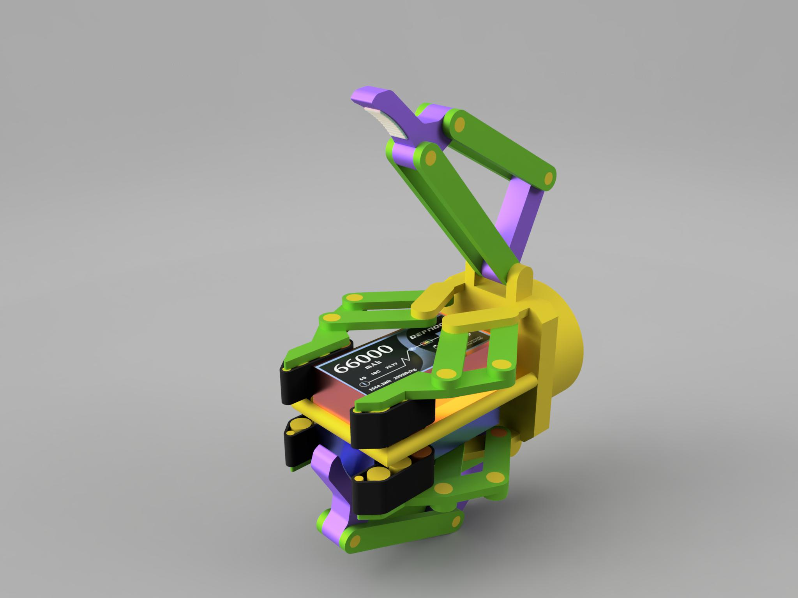
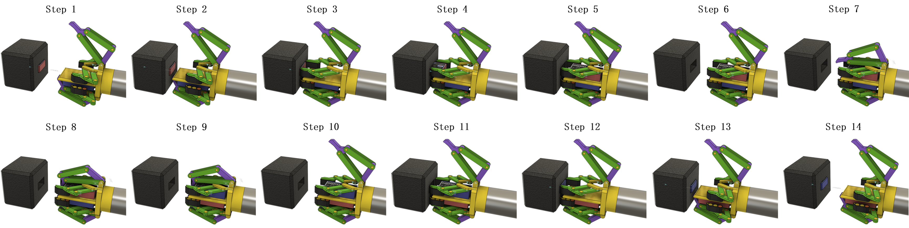
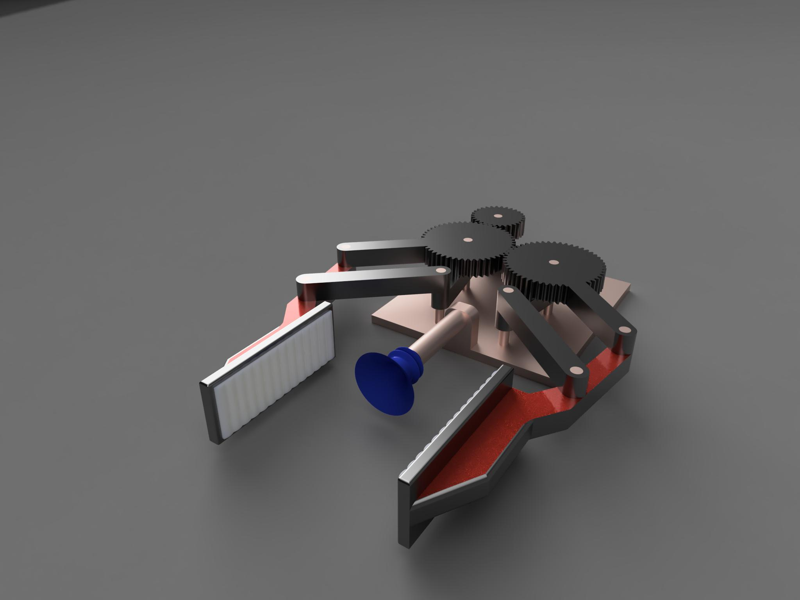
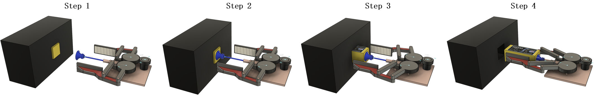
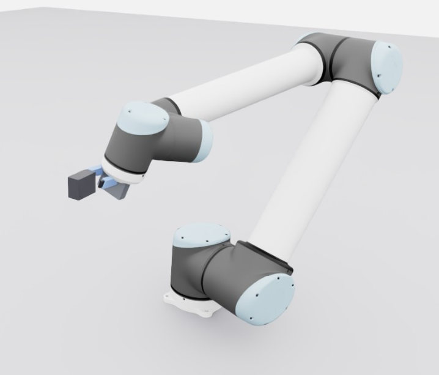

# Simulation-Based Robot Manipulation for Drone Battery Replacement

ZJUI Institute 2026 Summer Research Project #217

Multi-rotor drones such as the DJI Matrice 4 series fly for around 49 minutes per charge, so battery
swaps interrupt autonomous missions and still need a human. This project designs two robotic
end-effectors for automated battery replacement and validates the underlying grasp-and-align task in
simulation.

The problem that drives both designs: drone batteries have a narrow extended tip and sit deep inside
the drone body, leaving very little exposed area for a traditional rigid gripper to hold.

## Contents

- [Design A — Dual-Battery Belt Gripper](#design-a--dual-battery-belt-gripper)
- [Design B — Suction-Assisted Parallel Gripper](#design-b--suction-assisted-parallel-gripper)
- [Simulation and learning](#simulation-and-learning)
- [Results](#results)
- [Repository layout](#repository-layout)

## Design A — Dual-Battery Belt Gripper

A self-contained gripper that preloads a charged battery and swaps it with the depleted one in a
single motion.

- **Belt-driven fingers** generate high friction and spread the contact force over the battery's
  narrow tip, so the grasp does not slip or damage the cell.
- **Dual-battery storage** holds a charged battery alongside the discharged one, so no external
  battery stand is needed.
- **180° roll** after extraction repositions the charged battery for insertion into the drone slot,
  removing the need for secondary grippers or a reorientation station.



Swap sequence:



## Design B — Suction-Assisted Parallel Gripper

For batteries that sit deep in the drone with only a tiny edge exposed, a rigid parallel gripper
cannot reach far enough to grip.

- A **central suction cup** pulls the battery outward, increasing the exposed length.
- The **parallel fingers** then close on the now-accessible body of the battery.
- This design needs an extra place–pick–insert sequence, since the gripper cannot carry both
  batteries at once.



Swap sequence:



Both grippers are **conceptual proposals**. The simulation below validates the shared
grasp-and-align behaviour that either design would depend on; the mechanical designs themselves were
not simulated.

## Simulation and learning

Solving inverse kinematics (IK) for these constrained approach and grasp poses is complex and
computationally expensive, so the simulation replaces the IK solver entirely with a learned policy.

- **Environment:** Isaac Lab, 6-DOF UR10 manipulator with an authored parallel-jaw gripper.
- **Observations (25 dims):** 8 joint positions, 8 joint velocities, commanded end-effector pose
  (position + quaternion), finger state.
- **Actions (8 dims):** joint position targets — 6 for the arm, 2 for the fingers.
- **No IK solver is used anywhere in the control loop.** The robot learns the approach, grasp, and
  alignment trajectory on its own through deep reinforcement learning.



## Results

| Metric | Before training | After training |
| --- | --- | --- |
| End-effector alignment error | 1.05 m | < 7 cm |
| Grasp reward | 0 | 6.3 |
| Mean episode return | +1.11 | +80.05 |

The policy learned to align the end-effector with the battery and close the jaws on target, which
confirms the grasp task is achievable without an explicit IK solver.

- [Full research report (PDF)](results/report.pdf)

<br>


## Repository layout

```
renderings/
  design-a.jpg              Design A render
  design-b.jpg              Design B render
  ur10-learning.png         UR10 learning the grasp policy
  steps/
    design-a-steps.png      Design A swap sequence
    design-b-steps.png      Design B swap sequence
results/
  report.pdf                Full research report
  Summer Research Poster Hayk Soghomonyan 217.png   Project poster
```

## Limitations and next steps

The two gripper designs are conceptual and were not simulated mechanically, and the learned policy
covers the grasp-and-align task rather than a full pick-and-insert cycle. Next steps:

- Transfer the learned policies from Isaac Lab to a physical UR10 platform.
- Extend the simulation to the full pick-and-insert sequence.
- Simulate both mechanical gripper designs and build physical prototypes.
- Benchmark swap time, success rate, and alignment precision against industrial standards.

## Author

Hayk Soghomonyan — ZJUI Institute, 2026 Summer Research, supervised by Yang Liangjing.
